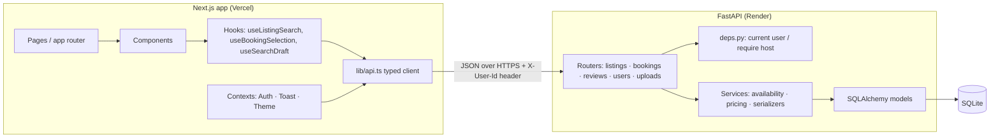
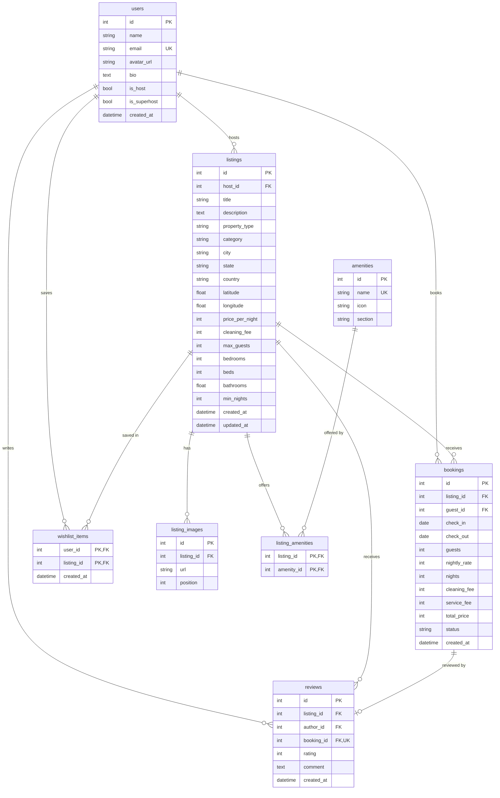

# stayhub: an Airbnb-style marketplace

A full-stack clone of Airbnb's core flows. Guests can browse and search homes, filter them, view a listing, pick dates and book a stay. Hosts can create, edit and delete listings and see their reservations. The UI follows Airbnb's own patterns: the explore grid with photo carousels, the category bar, the expanding search pill, the two-month date picker, the sticky reservation card, the photo tour and the guest-favorite badge.

| | |
|---|---|
| **Frontend** | Next.js 14 (App Router) · TypeScript · Tailwind CSS · Leaflet |
| **Backend** | Python 3.12 · FastAPI · SQLAlchemy 2.0 · Pydantic v2 |
| **Database** | SQLite (schema below) |
| **Live demo** | _add your Vercel URL here_ |

> **Brand.** The app is called `stayhub` and uses an original logo, so it doesn't reproduce Airbnb's trademarks. Everything else (layout, flows, spacing, colour, interactions) follows Airbnb. To rename it, change `BRAND_NAME` in `frontend/src/lib/format.ts`.

---

## Features

| Brief | What's implemented |
|---|---|
| **Home & search** | Responsive grid (1 to 6 columns, at Airbnb's breakpoints) with photo carousels, rating, location and price per night (or the total when dates are set). A search bar with *Where / Check in / Check out / Who* panels, which condenses to a pill on scroll and becomes a full-screen sheet on mobile. A category bar with 12 categories. A filters modal (price range slider, bedrooms, property type, amenities) that shows a live "Show N places" count. Infinite scroll with a "Show more" fallback. All search state is kept in the URL, so it can be shared and survives a refresh. |
| **Listing detail** | Five-photo mosaic plus a photo tour and full-screen viewer. Title, description, highlights, amenities grouped by section, and host info with host-wide stats. An inline availability calendar with booked nights struck through. Price breakdown (nightly rate × nights, cleaning fee and service fee). Reviews with a rating distribution and a "Show all" modal. A location map. |
| **Booking flow** | Date and guest validation on the client and again on the server: booked nights can't be picked, minimum stay and max guests are enforced, and past dates are rejected. *Confirm and pay* page with mocked payment. Confirmation page, **Trips** (upcoming, past and cancelled), cancellation. Bookings persist and block the dates. |
| **Host CRUD** | An 8-step listing wizard (type, category, location on a map, basics, amenities, photos by URL **or upload**, title, price) that is reused for editing. Delete is blocked while the listing has upcoming stays. The dashboard shows earnings, rating and reservations by status (*checking out / currently hosting / arriving soon / upcoming / past*). |
| **Airbnb experience** | Toasts with thumbnails and actions, wishlist hearts (optimistic, with rollback on error), modals and bottom sheets, a mobile tab bar, skeleton loaders and empty states. |
| **Placeholders** | Messaging, Experiences, language/currency and the Help Center show "Coming soon". Payment is simulated. Login is mocked (see below). |
| **Bonus** | Interactive map with price pins ✓ · reviews after a completed stay ✓ · Superhost badges and rating aggregation ✓ · image upload ✓ (local disk) · dark mode ✓ · responsive mobile, tablet and desktop ✓ |

### Demo accounts

There are no passwords. Click **Log in** and pick an account:

| Account | Role | Good for trying |
|---|---|---|
| Priya Sharma | Superhost (6 listings) | Host dashboard, editing, reservations |
| Daniel Brooks / Sofia Rossi | Superhosts | More host data |
| Aarav Patel | Guest | Booking, Trips, a completed stay waiting for a review, a pre-filled wishlist |
| Emma, Kabir, Lena | Guests | Booking |

Any guest can click **Host your home → Start hosting** to become a host.

---

## Running locally

**Prerequisites:** Python 3.10+ and Node 18.18+.

```bash
# 1. API → http://localhost:8000  (interactive docs at /docs)
cd backend
python -m venv .venv && source .venv/bin/activate     # Windows: .venv\Scripts\activate
pip install -r requirements.txt
uvicorn app.main:app --reload
```

The first start creates `airbnb.db` and seeds it with 9 users, 38 listings across 15 countries, about 150 past stays with reviews, and upcoming bookings that block dates. To reset everything, run `python -m app.seed --reset`.

```bash
# 2. Web app → http://localhost:3000
cd frontend
cp .env.example .env.local        # NEXT_PUBLIC_API_URL=http://localhost:8000
npm install
npm run dev
```

**Tests**

```bash
cd backend && pytest              # 12 API tests: search, overlap rules, CRUD, ownership, reviews, contract
cd frontend && npm test           # date/availability and URL-state helpers
cd frontend && npm run typecheck
```

---

## Architecture



```
backend/app/
  main.py            app factory, CORS, lifespan (create tables + seed)
  config.py          env-driven settings
  database.py        engine (SQLite FK pragma on), session dependency
  models.py          ORM schema
  schemas.py         Pydantic request/response models (the API contract)
  constants.py       property types & categories accepted by the API
  deps.py            mocked auth: X-User-Id → User; require_host guard
  routers/           HTTP layer only: parse, authorize, call services
  services/
    availability.py  overlap rule + validate_stay() shared by quote and booking
    pricing.py       the single price formula used by quote and booking
    serializers.py   batch rating/wishlist aggregation (no N+1)
  seed.py, seed_data.py
frontend/src/
  app/               routes: /, /rooms/[id], /book/[id], /trips, /trips/[id], /wishlists, /hosting, /hosting/listings/…
  components/        explore/ listing/ booking/ hosting/ search/ layout/ ui/
  context/           AuthContext (mock login), ToastContext, ThemeContext
  lib/               api client, types (mirror schemas.py), dates, URL state, formatting
```

**Key decisions**

- **Routers stay thin; rules live in services.** `validate_stay()` backs both `GET /quote` and `POST /bookings`, and `pricing.quote()` is the only price formula. So the price a guest sees is exactly what gets stored, and the calendar can't allow a stay the API would reject.
- **Bookings are created atomically.** The availability check and the INSERT run under a lock, so two simultaneous requests can't both take the same nights. On Postgres this would become an exclusion constraint.
- **The URL is the state for search.** Explore filters and the listing page's dates and guests live in query params, so back/forward, refresh and sharing all work.
- **Client-side data fetching.** Mock auth lives in `localStorage`, and wishlist flags and permissions depend on the user, so pages fetch on the client and show skeleton loaders. With real cookie auth, the listing page would move to server rendering.
- **Dates are plain `YYYY-MM-DD` strings end to end.** Nothing goes through UTC, so stays never shift by a day across timezones.

---

## Database schema



**Design notes**

- **Stays are half-open ranges `[check_in, check_out)`.** Two stays overlap when `a.check_in < b.check_out AND a.check_out > b.check_in`, so same-day turnover is allowed, as on Airbnb. The composite index `(listing_id, check_in, check_out)` serves exactly this query.
- **Bookings snapshot their price** (`nightly_rate`, fees, `total_price`). A later price edit doesn't rewrite past receipts.
- **Each review belongs to a booking** (`booking_id` UNIQUE). Only real guests can review, only after checkout, and only once per stay.
- **The wishlist uses a composite primary key** `(user_id, listing_id)`, so a listing can't be saved twice and `PUT` stays idempotent.
- **Integrity lives in the database too.** There are `CHECK` constraints (price > 0, `check_out > check_in`, rating 1–5, status enum), `ON DELETE CASCADE` on child rows, and SQLite foreign keys are switched on per connection.
- **Ratings are computed, not stored.** They're aggregated with one `GROUP BY` per page, which avoids N+1 queries and stale counters.
- **Money is stored as whole integers (₹).** That avoids float rounding.
- **Cancelling keeps the row.** `status='cancelled'` frees the dates while keeping the history.

---

## API overview

Interactive docs are at **`/docs`** (Swagger). Auth is mocked: send `X-User-Id: <id>`.

| Method | Path | Auth | Purpose |
|---|---|---|---|
| GET | `/listings` | optional | Search. Query params: `location, check_in, check_out, guests, category, property_types, min_price, max_price, bedrooms, beds, bathrooms, amenities, superhost, page, page_size`. Returns `{items, total, page, pages}` |
| GET | `/listings/{id}` | optional | Detail with photos, amenities, reviews, host and host stats, rating, `is_wishlisted` |
| GET | `/listings/{id}/availability` | – | Upcoming booked ranges (used by the calendar) |
| GET | `/listings/{id}/quote` | – | Validates the stay and returns the price breakdown |
| POST · PUT · DELETE | `/listings`, `/listings/{id}` | host, owner | Create / replace / delete (delete returns 409 if there are upcoming stays) |
| POST | `/bookings` | user | Book. Returns 409 if the dates were taken, 400 if a rule is broken |
| GET | `/bookings/mine` · `/bookings/{id}` | guest or host | Trips / a single reservation |
| POST | `/bookings/{id}/cancel` | guest or host | Cancel an upcoming stay |
| POST | `/reviews` | guest of a completed stay | One review per booking |
| GET · PUT · DELETE | `/me/wishlist`, `/me/wishlist/{listing_id}` | user | Wishlist (PUT is idempotent) |
| GET | `/host/listings` · `/host/reservations` | host | Dashboard data |
| GET · POST | `/users`, `/me`, `/me/become-host` | – / user | Demo login and role switch |
| GET | `/meta` | – | Property types, categories, amenities (by section), price range |
| POST | `/uploads` | host | Image upload (JPG/PNG/WebP/GIF, 5 MB max) → `{url}` |

Errors always come back as `{"detail": "..."}` with a message written for people (e.g. *"Those dates are no longer available"*), and the frontend shows that text as-is in toasts.

---

## Deployment

**API on Render.** Click *New → Blueprint* and select this repo (it uses `render.yaml`). Alternatively, create a *Web Service* with root `backend`, build command `pip install -r requirements.txt`, and start command `uvicorn app.main:app --host 0.0.0.0 --port $PORT`. Set these environment variables:
- `CORS_ORIGINS`: your Vercel URL (`*.vercel.app` previews are already allowed)
- `PUBLIC_API_URL`: the service's own URL (used to build URLs for uploaded photos)

**Web app on Vercel.** Import the repo, set **Root Directory** to `frontend`, and add `NEXT_PUBLIC_API_URL=https://<your-api>.onrender.com`.

> Free hosting tiers have an ephemeral disk, so the SQLite database and uploads reset when the service redeploys or restarts. Since the API reseeds itself on boot, the demo always comes back in a usable state. For durable data, attach a persistent disk and point `DATABASE_URL` and `UPLOAD_DIR` at it.

---

## Assumptions and trade-offs

- **Auth is mocked**, as the brief allows. The user's id is stored in `localStorage` and sent as a header. Replacing it with real auth would only touch `deps.py` and `AuthContext`.
- **Prices are in INR** with a 14% guest service fee and a per-listing cleaning fee. Taxes aren't modelled ("Total before taxes").
- **Infants and pets don't count toward a listing's guest limit**, as on Airbnb.
- **The minimum stay is enforced.** Seeded listings over ₹20,000/night require 2 nights. The maximum stay is 90 nights.
- **Only upcoming stays can be cancelled**, by the guest or the host. Refunds are simulated.
- **Search matches on city, state, country or title.** There's no geocoding, so hosts place their pin by clicking the map.
- **Photos.** Seed photos come from Unsplash. If a remote photo fails to load, a neutral placeholder is shown instead. Uploads go to local disk; to use cloud storage, swap `routers/uploads.py` for S3 or Cloudinary, since only the returned URL matters to the frontend.
- **Map tiles** are OpenStreetMap data via CARTO's free basemap.
